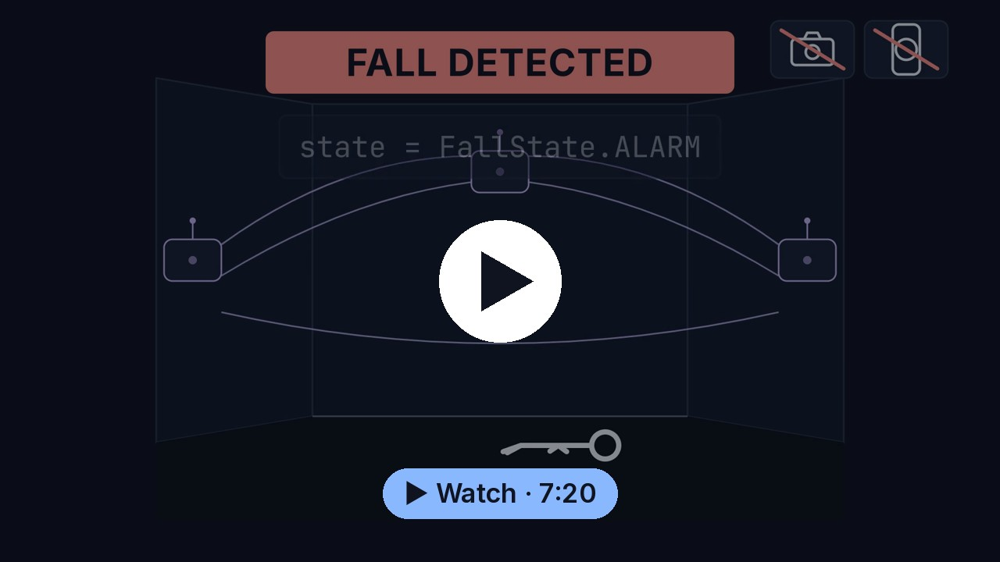

# Licenta: Wi-Fi fall detection

Three ESP32 boards notice a human fall from Wi-Fi signals alone. No camera, no wearable.

[](media/licenta-explained.mp4)

**▶ Click the picture to watch the 7-minute explainer**: from radio waves to the alarm, line by line.

## Try it

```bash
python -m venv .venv && .venv/bin/pip install numpy scipy matplotlib PyQt6 pyqtgraph pyserial
cd src && ../.venv/bin/python -m csi.gui --replay
```

Replays a real recorded fall on a loop. No hardware needed.
