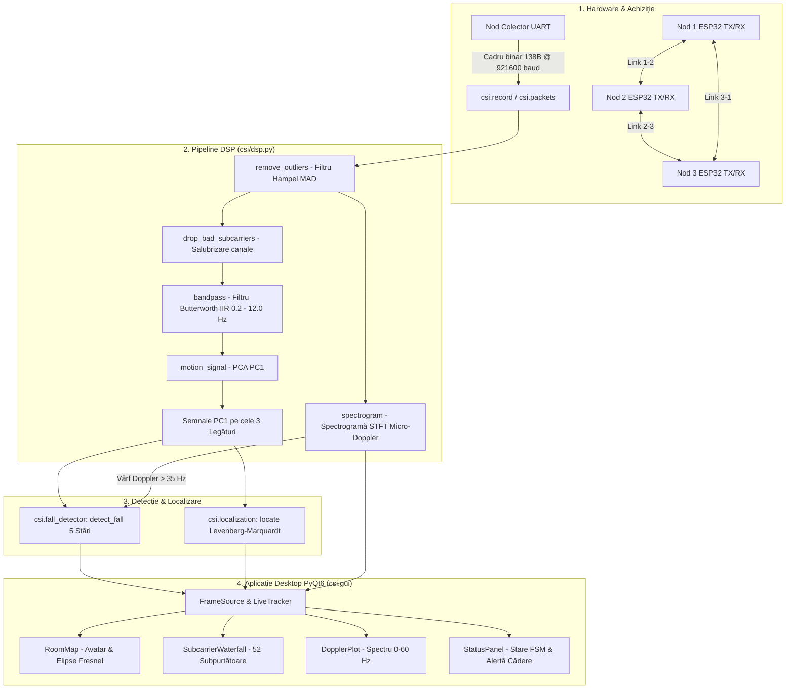

# 🏗️ Arhitectura Sistemului de Detecție și Cartografiere

Sistemul implementează un lanț complet de achiziție, procesare de semnal și decizie bazat pe perturbația semnalului Wi-Fi CSI (**Channel State Information**) provocată de corpul uman într-un spațiu închis (5m × 5m). Întregul cod este organizat în pachetul modular Python [`src/csi/`](file:///home/vlads4r4/dev/Licenta/src/csi).

---

## 🔁 Fluxul Tehnic Cap-la-Coadă

---

## 🧩 Componentele Pipeline-ului

### 1. Nivelul Fizic & Achiziție
* **Emițător/Receptor:** 3 noduri [[Noduri ESP32 Mesh]], canalul Wi-Fi 6 (2.437 GHz, $\lambda \approx 12.3\text{ cm}$), definite în [`src/csi/room.py`](file:///home/vlads4r4/dev/Licenta/src/csi/room.py).
* **Format date:** Matrice $H \in \mathbb{C}^{N \times 52}$ per legătură radio, transmisă prin [[Protocol Binar UART]] și decodată de [`src/csi/packets.py`](file:///home/vlads4r4/dev/Licenta/src/csi/packets.py).

### 2. Condiționare Semnal (DSP în [`src/csi/dsp.py`](file:///home/vlads4r4/dev/Licenta/src/csi/dsp.py))
* **Eliminare zgomot LNA:** [[Filtrare Hampel si Butterworth#Filtru Hampel|Filtru Hampel]] (`remove_outliers`) bazat pe abaterea mediană absolută (MAD).
* **Salubrizare subpurtătoare:** `drop_bad_subcarriers` elimină canalele degenerate ($0.05 \le \text{Var} \le 350.0$).
* **Filtrare trece-bandă:** [[Filtrare Hampel si Butterworth#Filtru Butterworth|Butterworth IIR]] ordinul 4 (0.2–12 Hz) cu fază zero (`bandpass`).
* **Fuziune dimensională:** [[Analiza PCA si Selectie Subpurtatoare]] extrage primul vector propriu (`motion_signal`), maximizând SNR-ul mișcării.
* **Analiză frecvență-timp:** [[Spectrograma Micro-Doppler]] (`spectrogram`) detectează viteza de coborâre gravitațională ($v > 2\text{ m/s} \implies f_D > 35\text{ Hz}$).

### 3. Logică Decizională
* **Detecție:** [[Detector Cadere FSM]] prin funcția `detect_fall` din [`src/csi/fall_detector.py`](file:///home/vlads4r4/dev/Licenta/src/csi/fall_detector.py):
  1. Activitate în încăpere ([[Activity Gate si Praguri Cinematice]]).
  2. Colaps simultan al pantei pe $\ge 2$ legături radio ($|dA/dt| > 17.5$).
  3. Fereastră de monitorizare a imobilității la sol ($2.5\text{ s}$, varianță $< 0.20$).
* **Localizare:** [[Localizare 2D Elipse Fresnel]] calculează coordonatele $(x, y)$ prin `locate` din [`src/csi/localization.py`](file:///home/vlads4r4/dev/Licenta/src/csi/localization.py).

### 4. Monitorizare Desktop ([`src/csi/gui/`](file:///home/vlads4r4/dev/Licenta/src/csi/gui))
* Aplicație multithreaded în PyQt6 ([[Arhitectura PyQt6 Desktop]]), lansată prin `python -m csi.gui`, cu redare live sau replay și componente grafice specializate ([[Telemetrie si Widgets]]).

---

## 🔗 Legături Directe către Codul Sursă
* Geometrie cameră & constante: [`src/csi/room.py`](file:///home/vlads4r4/dev/Licenta/src/csi/room.py)
* Decodare pachete UART & înregistrări: [`src/csi/packets.py`](file:///home/vlads4r4/dev/Licenta/src/csi/packets.py)
* Achiziție serială live: [`src/csi/record.py`](file:///home/vlads4r4/dev/Licenta/src/csi/record.py)
* Algoritmi filtrare & DSP: [`src/csi/dsp.py`](file:///home/vlads4r4/dev/Licenta/src/csi/dsp.py)
* Detector cădere FSM: [`src/csi/fall_detector.py`](file:///home/vlads4r4/dev/Licenta/src/csi/fall_detector.py)
* Localizare elipse Fresnel: [`src/csi/localization.py`](file:///home/vlads4r4/dev/Licenta/src/csi/localization.py)
* Simulator fizic CSI: [`src/csi/simulator.py`](file:///home/vlads4r4/dev/Licenta/src/csi/simulator.py)
* Generare figuri teză: [`src/csi/figures.py`](file:///home/vlads4r4/dev/Licenta/src/csi/figures.py)
* Interfață PyQt6: [`src/csi/gui/__main__.py`](file:///home/vlads4r4/dev/Licenta/src/csi/gui/__main__.py)
