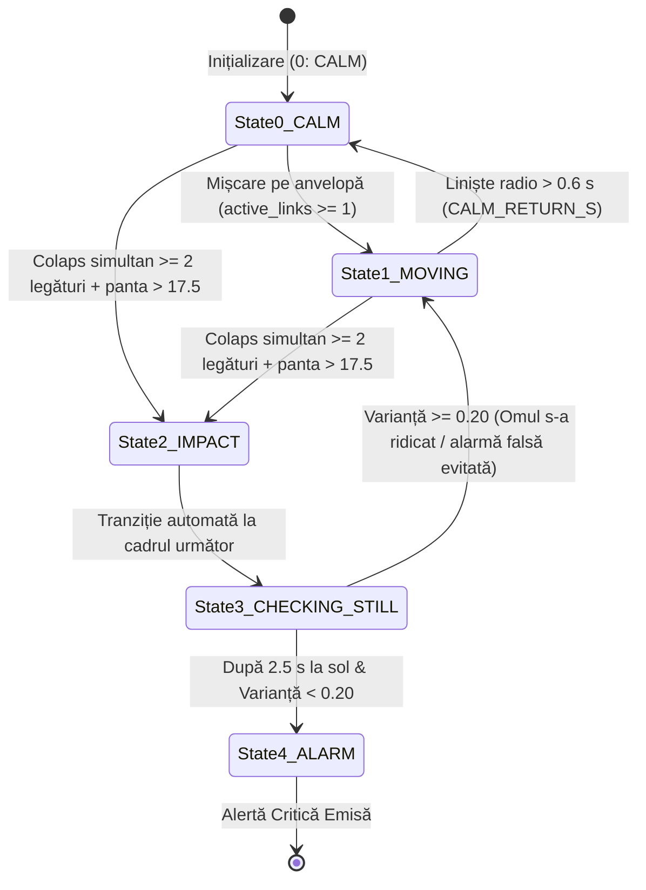

# 🛡️ Detector de Cădere bazat pe FSM Analitic

Detectorul principal este implementat ca un automat cu stări finite (**Finite State Machine - FSM**) în fișierul [`src/csi/fall_detector.py`](file:///home/vlads4r4/dev/Licenta/src/csi/fall_detector.py) prin funcția `detect_fall`.

Acesta clasifică determinist secvența temporală de mișcare umană conform modelului **RT-Fall (Wang et al., 2014)**.

---

## 🔀 Diagrama Stărilor FSM (`FallState`)



### Etichete în Cod și GUI (`STATE_LABELS`)
* `FallState.CALM = 0` $\to$ `"CALM"`
* `FallState.MOVING = 1` $\to$ `"MERS"`
* `FallState.IMPACT = 2` $\to$ `"IMPACT"`
* `FallState.CHECKING_STILL = 3` $\to$ `"VERIFICARE"`
* `FallState.ALARM = 4` $\to$ `"ALARMĂ"`

---

## 📜 Constante și Praguri Cinematice

```python
SLOPE_ACTIVE = 0.05               # Prag activare mișcare pe legătură
IMPACT_SLOPE = 17.5               # Prag pantă impact violent gravitațional (> 2.5 m/s)
MIN_LINKS_AT_IMPACT = 2           # Fuziune multi-link: minim 2 legături concomitente
CALM_RETURN_S = 0.6               # Fereastră de revenire la calm (600 ms)
IMPACT_SETTLE_S = 0.5             # Pauză de stabilizare a undelor post-impact (500 ms)
STILL_WINDOW_S = 2.5              # Fereastră de monitorizare a imobilității la sol
STILL_MAX_VARIANCE = 0.20         # Varianța maximă admisă a corpului inert la podea
EMPTY_ROOM_STD_SIMULATED = 0.20   # Activity gate pe date simulate normalizate
EMPTY_ROOM_STD_HARDWARE = 11.0    # Activity gate pe date hardware brute ADC
```

---

## ⚙️ Logica Funcției `detect_fall(times_s, motion_by_link, rate_hz)`

1. **Poarta de Activitate (Activity Gate):**
   Dacă media deviațiilor standard ale legăturilor este sub pragul de cameră goală, returnează imediat `Detection(states, None, None)`.
2. **Normalizare și Pante Instantanee:**
   Fiecare semnal PC1 este normalizat la $[-1, 1]$ prin `_normalized`, apoi se calculează derivata prin gradient numeric `_slopes`.
3. **Detecție Impact:**
   Condiție: `active_links >= 2` concomitent cu `any(slope > 17.5)`. Se marchează `impact_time_s`.
4. **Verificare Imobilitate (`_is_still`):**
   După expirarea a $2.5\text{ s}$ (`STILL_WINDOW_S`), dacă varianța medie pe fereastra post-impact este sub $0.20$, starea devine `FallState.ALARM` și se emite `alarm_time_s`.
5. **Latență Măsurată:**
   Pe fișierul real `test_C_cadere_reala.npz`, impactul are loc la **4.35 s**, iar alarma este confirmată la **7.36 s** $\implies$ latență totală de decizie de **3.01 s**.

---

## 📊 Telemetria FSM în Timpul Căderii

![[4_fsm_decision_telemetry.png|800]]

*Evoluția stărilor FSM corelată cu scăderea altitudinii centrului de masă (CoM) și momentul declanșării alertei.*
