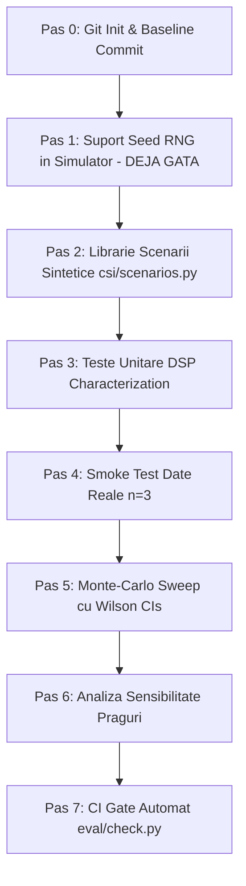

# 🛠️ Plan de Integrare: Eval Harness & Gated CI (Pattern 4)

Documentul de referință se află în [`docs/Plans/cv-patterns-integration.md`](file:///home/vlads4r4/dev/Licenta/docs/Plans/cv-patterns-integration.md).

Acesta analizează modul în care repo-ul de licență trebuie consolidat din punct de vedere al testării și verificării inginerești (Pattern 4), eliminând "hype-ul" de agenți sau LLM forțat într-un lanț determinist de procesare de semnal.

---

## 🎯 De ce Doar Pattern 4 Are Sens în Acest Repo

* Repo-ul actual are **zero teste automate unitare** în `tests/` (are doar capturi de screenshot pentru GUI).
* Simulatorul anterior avea un singur scenariu hardcodat; în noul pachet [`src/csi/simulator.py`](file:///home/vlads4r4/dev/Licenta/src/csi/simulator.py), funcția `simulate_csi` a primit deja suport pentru `seed`, facilitând execuția reproductibilă.
* Companiile tehnice (Arobs, Bending Spoons, LSEG, Riverbed, Qubiz) caută disciplină de testare, CI și măsurători statistice reproductibile, nu scenarii artificiale.

---

## 📋 Cei 8 Pași de Implementare (Efort: 5–7 zile)

### Pas 0: Inițializare Git
* Executat `git init` și primul commit baseline pentru urmărirea regresiei.

### Pas 1: Suport RNG Seed (Implementat)
* În [`src/csi/simulator.py`](file:///home/vlads4r4/dev/Licenta/src/csi/simulator.py), `simulate_csi(trajectory, snr_db=22.0, add_spikes=True, seed=0)` este deja integrat cu `np.random.default_rng(seed)`.

### Pas 2: Librărie de Scenarii Sintetice
* Modul nou `src/csi/scenarios.py`:
  * `scenario_empty_room()` (cameră goală, doar zgomot)
  * `scenario_walk_only()` (mers continuu fără cădere)
  * `scenario_sit_down()` (așezare pe scaun, viteză mică pe Z)
  * `scenario_lie_down()` (culcare lentă în pat)
  * `scenario_fall_variable(t_fall)` (cădere la momente variabile)

### Pas 3: Teste Unitare DSP (Characterization Tests)
* În folderul `tests/`: verificat `hampel_filter_1d`, `butterworth_bandpass`, `compute_pca_first_component` și spectrograma STFT pe sinusoide pure de frecvență $f_0$. Tratare cazuri limită (array gol, `NaN`, semnal scurt).

### Pas 4: Smoke Test pe Date Reale ($n=3$)
* Test automat `pytest` care verifică:
  * `test_A_camera_goala.npz` $\implies$ fără alarmă
  * `test_B_mers_normal.npz` $\implies$ fără alarmă
  * `test_C_cadere_reala.npz` $\implies$ alarmă declanșată

### Pas 5: Monte-Carlo Sweep
* Script `eval/run_sweep.py`: Scenarii $\times$ SNR $\{0, 5, 10, 20, 30\}\text{ dB}$ $\times$ Outliers $\times$ $K$ seed-uri.
* Calculează rate de detecție, alarme false și intervale de încredere Wilson (Wilson Score Interval). Salvează în `eval/results.json`.

### Pas 6: Analiză de Sensibilitate pe Praguri
* Variază `TH_DERIVATIVE`, `TH_DOPPLER_HIGH`, `DORMANCY_WINDOW_SEC`.
* Raportează asumat discrepanța $0.20$ sintetic vs $11.0$ hardware ([[Activity Gate si Praguri Cinematice]]).

### Pas 7: Poartă CI Automată (Gated Gate)
* `eval/check.py`: compară orice rulare nouă cu `eval/baseline.json`. Dacă rata de detecție scade peste marjă, iese cu cod de eroare nenul (`sys.exit(1)`).
