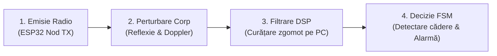

# 💡 Ghid pentru Începători: Cum "Vede" Wi-Fi-ul Mișcarea Fără Nicio Cameră Video

> [!tip] Pentru cine este această notiță?
> Această notiță explică tema lucrării de licență de la zero, fără formule complicate și fără termeni tehnici lăsați neexplicați. Dacă nu ai mai auzit niciodată de unde radio, microcontrolere sau procesare de semnal, acesta este cel mai bun punct de plecare!

---

## 🧸 1. Ce vrea să facă acest proiect (explicat ca pentru un copil de 10 ani)

Imaginează-ți că în camera ta există o **plasă invizibilă de păianjen** țesută din fire de lumină pe care ochiul uman nu le poate vedea. Când camera este goală, firele stau perfect întinse și nemișcate.

Când intri în cameră și pășești, corpul tău atinge și zdruncină ușor aceste fire invizibile. Plasa începe să vibreze ritmic, exact ca pașii tăi. 

Dacă însă te împiedici și **cazi brusc pe podea**:
1. Plasa este lovită cu putere de sus în jos – produce o vibrație uriașă și rapidă (un șoc).
2. Imediat după cădere, dacă ai rămas întins pe podea și nu te poți mișca, plasa devine dintr-o dată complet nemișcată la nivelul solului.

Aparatul nostru ascultă aceste vibrații invizibile. Când simte șocul brusc urmat de o liniște suspectă la podea, știe instantaneu: **„Cineva a căzut și are nevoie de ajutor!”** și trimite o alertă pe telefonul familiei sau al medicului.

Totul se întâmplă **fără să porți niciun ceas sau brățară**, și cel mai important: **fără nicio cameră video** care să te filmeze în ipostaze intime.

---

## 🦇 2. Metafora Sonarului și a Liliecilor: Cum funcționează „Radarul Wi-Fi”

Liliecii au o vedere foarte slabă, dar pot zbura noaptea cu viteză prin peșteri întunecoase fără să se lovească de stânci sau pereți. Cum reușesc?

1. Liliacul scoate un sunet foarte ascuțit (ultrasunete pe care urechea omului nu le aude).
2. Unda de sunet călătorește prin aer, lovește peretele, tavanul sau o insectă și se **întoarce înapoi ca un ecou**.
3. Urechile mari ale liliacului prind ecoul. Creierul lui calculează: *„Sunetul a plecat la ora 12:00:00 și s-a întors la 12:00:02. Înseamnă că peretele este la 2 metri distanță!”*. Din mii de astfel de ecouri, liliacul desenează în minte o hartă 3D a peșterii. Aceasta se numește **ecolocație** (sau sonar).

```
   [Emițător Wi-Fi]  ~~~~~~~~ (Undă directă) ~~~~~~~~>  [Receptor Wi-Fi]
          \                                                  ^
           \                                                /
            \~~~ (Undă reflectată) ~~~> [ Corp Om ] ~~~~~~~/
                                          (Ecou)
```

Sistemul nostru face **exact același lucru**, dar în loc de sunete folosește **undele radio invizibile ale routerului Wi-Fi**:
* Un nod mic Wi-Fi (emițătorul) trimite continuu semnale radio în cameră (de 100 de ori pe secundă).
* Semnalul se împrăștie peste tot: o parte merge drept spre celălalt nod, iar o altă parte se lovește de pereți, mobilă și de **corpul tău**, ricoșând ca o minge de tenis.
* Celălalt nod mic Wi-Fi (receptorul) ascultă toate aceste ecouri. Când tu te miști, traseul ecoului se schimbă, iar receptorul „vede” această schimbare în timp real!

---

## 🛡️ 3. De ce „Device-Free”? (Fără Brățară, Ceas sau Cameră)

Există deja pe piață brățări inteligente sau ceasuri care detectează căderile (precum Apple Watch). De asemenea, există camere de supraveghere. De ce am vrut un sistem diferit?

> [!info] Realitatea dură a îngrijirii bunicilor
> * **Bunicii uită:** Persoanele în vârstă uită frecvent să își pună brățara la mână dimineața sau după duș, sau uită să o bage la încărcat. O brățară lăsată pe noptieră nu salvează pe nimeni când omul cade în bucătărie.
> * **Cele mai periculoase căderi se întâmplă noaptea și la baie:** Podeaua umedă din baie și trezitul brusc din somn sunt factorii numărul 1 de accidente casnice la bătrâni.
> * **Problema intimității (Camerele video):** Nimeni nu este de acord să aibă o cameră video instalată în baie sau în dormitor! Este o intruziune inacceptabilă în viața privată.

**Soluția noastră se numește „Device-Free” (Fără dispozitiv pe corp):**
1. **Zero efort pentru utilizator:** Nu porți nimic pe mână, nu ai senzori în buzunar, nu încarci baterii zilnic.
2. **Intimitate 100% garantată:** Undele radio nu fac poze și nu înregistrează fețe sau corpuri dezbrăcate. Ele măsoară doar o serie de cifre (amplitudinea și faza semnalului). Pentru sistem, omul este doar un obiect fizic care dispersează undele.
3. **Complet pasiv:** Dacă persoana cade și își pierde cunoștința, nu trebuie să apese pe niciun buton de panică. Sistemul declanșează alerta automat.

---

## 📊 4. Diferența Crucială: RSSI vs. CSI

Când te uiți pe telefonul mobil, vezi în colțul ecranului 3 sau 4 liniuțe de semnal Wi-Fi. Acela este **RSSI**. De ce nu putem folosi acele liniuțe pentru a detecta o cădere cu precizie?

### RSSI (Received Signal Strength Indicator) = O singură cifră brută
* **Analogia volumului:** RSSI este ca și cum ai asculta o orchestră întreagă și ai măsura doar cât de tare se aude în total în cameră.
* Dacă cineva închide ușa, volumul scade. Dacă cineva trece prin cameră, volumul poate scădea puțin. Dar la fel scade și dacă a trecut o pisică, dacă s-a pornit cuptorul cu microunde sau dacă a bătut vântul prin perdea.
* Este o singură valoare numerică (ex: `-65 dBm`). Din această singură cifră nu poți ști dacă cineva a căzut, a clipit sau a deschis frigiderul. Alarmele false ar fi la ordinea zilei.

### CSI (Channel State Information) = Radiografia completă pe fiecare frecvență
* **Analogia radiografiei medicale:** În loc de o simplă medie, CSI descompune unda Wi-Fi în **52 de frecvențe individuale paralele** (numite subpurtătoare).
* Pentru fiecare dintre aceste 52 de frecvențe, CSI măsoară două lucruri fundamentale:
  1. **Amplitudinea:** Cât de tare a slăbit unda la acea frecvență exactă.
  2. **Faza:** Cu cât s-a rotit sau decalat unda în timp după ce a ricoșat din tine.

| Caracteristică | RSSI (Liniuțele de pe telefon) | CSI (Informația de Stare a Canalului) |
| :--- | :--- | :--- |
| **Ce reprezintă?** | Puterea totală cumulată a semnalului | Detaliul fin pe fiecare dintre cele 52 de frecvențe |
| **Cantitate de date** | 1 singur număr la fiecare secundă | 52 de numere complexe (amplitudine + fază) la fiecare pachet |
| **Analogia** | O umbră vagă pe un perete | O radiografie medicală de înaltă rezoluție |
| **Sensibilitate** | Detectează doar dacă te-ai îndepărtat mult | Detectează chiar și respirația sau viteza unei căderi |
| **Alarme false** | Foarte mari (zgomot ambiental necontrolat) | Reduse masiv (filtrat prin algoritmi inteligenți) |

---

## 🔄 5. Cei 4 Pași ai Sistemului (Cum circulă informația)

Întregul sistem din această lucrare de licență funcționează într-o buclă automată compusă din 4 etape majore:



### Pasul 1: Emisia Radio (Nodul TX)
* Un mic modul electronic [[01 - Dictionar Hardware si Retea#ESP32|ESP32]] trimite continuu pachete de date prin aer pe Canalul 6 Wi-Fi ($2.437\text{ GHz}$).
* Undele pleacă în toate direcțiile cu viteza luminii ($300.000\text{ km/s}$).

### Pasul 2: Perturbarea de către Corpul Uman
* Corpul omului este format din peste 70% apă și săruri minerale. Din punct de vedere fizic, omul acționează ca o **oglindă reflectorizantă mobilă** pentru undele radio.
* Când corpul se mișcă, lungimea drumului parcurs de ecou se modifică la fiecare milimetru. Dacă omul cade, viteza mare de prăbușire comprimă undele și creează un fenomen numit **Efect Doppler** (ca sirena unei ambulanțe în viteză).

### Pasul 3: Recepția și Filtrarea pe Calculator (DSP)
* Alte două noduri [[01 - Dictionar Hardware si Retea#ESP32|ESP32]] (receptoarele) prind undele și extrag valorile CSI brute.
* Datele sunt trimise fulgerător prin cablu USB la calculator (printr-un protocol binar ultrarapid).
* Pe calculator, algoritmi matematici speciali ([[Filtrare Hampel si Butterworth|filtrele Hampel și Butterworth]]) curăță zgomotul electronic al aparatelor și păstrează doar frecvențele tipice mișcării umane ($0.2\text{ - }12\text{ Hz}$).

### Pasul 4: Automat de Decizie și Alertă (FSM)
* Calculatorul calculează o [[Spectrograma Micro-Doppler|spectrogramă Doppler]] și verifică viteza mișcării.
* Un „creier logic” numit [[Detector Cadere FSM|Automat Finit de Stări (FSM)]] urmărește secvența exactă:
  1. *Omul mergea normal.*
  2. *Urmează o prăbușire bruscă cu viteză de peste $2.5\text{ m/s}$ (vârf Doppler peste $35\text{ Hz}$).*
  3. *Urmează o liniște prelungită la nivelul podelei (faza de nemișcare / latență).*
* Dacă după 2.5 secunde omul nu s-a ridicat, ecranul devine roșu și se declanșează alerta sonoră și vizuală!

---

## 🧭 Unde mergi mai departe?

Pentru a aprofunda fiecare piesă din acest puzzle fascinant, citește următoarele dicționare explicative:

1. 🔌 [[01 - Dictionar Hardware si Retea]] — Află de ce am ales cipurile ESP32 de 20 de lei, ce înseamnă autostrada cu 52 de benzi OFDM și cum trimitem datele pe fir fără să pierdem niciun octet.
2. 🌊 [[02 - Dictionar Fizica si Propagare Unde]] — Înțelege cum ricoșează undele prin cameră, ce este „balonul de rugby invizibil” (zona Fresnel) și cum ne dă de gol efectul Doppler când ne împiedicăm.
3. 📚 [[03 - Dictionar Matematica si DSP]] — Bucătăria semnalelor: numere complexe, filtre Butterworth și spectrograma STFT.
4. 🏛️ [[01 - Arhitectura Sistem]] — Vezi schema tehnică de ansamblu și fluxul de execuție software al întregului proiect.
5. 🏠 [[00 - Start Aici]] — Întoarce-te la tabla de bord principală a licenței.
