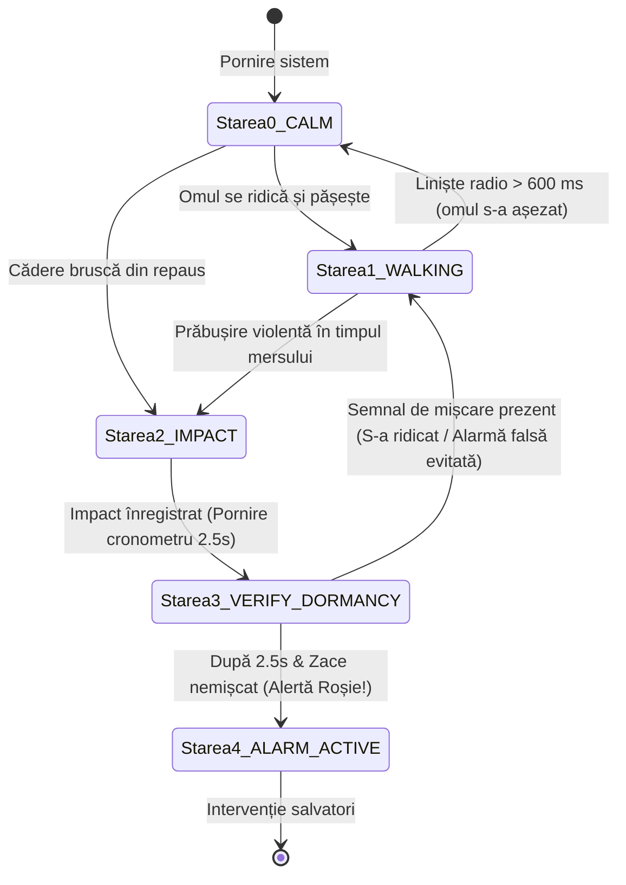

# 🤖 Dicționar Algoritmi și Software

> [!tip] Pentru cine este acest ghid?
> În [[03 - Dictionar Matematica si DSP]] am văzut cum curățăm semnalul în bucătăria DSP. Acum ne punem întrebarea cheie: **Cum facem calculatorul să gândească și să ia decizii de viață și de moarte?**
> Aici vei înțelege ce este un automat cu stări, cum funcționează "portarul" sistemului, cum găsește detectivul matematic poziția omului și de ce avem nevoie de un bucătar și un ospătar pentru ca ecranul să nu înghețe niciodată.

---

## 🚦 1. FSM (Finite State Machine): Automatul de Cafea sau Semaforul

**FSM** (*Finite State Machine* sau *Automat cu Stări Finite*) este mecanismul de luare a deciziilor din proiectul nostru.

* **De ce nu folosim o mie de condiții `if / else` încâlcite?**
  Dacă scrii un program mare doar cu `if` și `else`, se creează rapid un haos: codul ajunge să verifice aceleași lucruri la nesfârșit, apar stări imposibile (cum ar fi să sune alarma când camera e goală), iar depanarea devine un coșmar.
* **Analogia Automatul de Cafea:**
  Gândește-te la tonomatul de cafea de la facultate. El are reguli de fier și nu poate fi decât într-**o singură stare** la un moment dat:
  1. `AȘTEAPTĂ BANII`: Stă liniștit. Dacă apeși pe butonul de espresso, nu face nimic.
  2. `MONEDĂ INTRODUSĂ`: Doar acum îți deblochează butoanele de selecție.
  3. `PREPARARE`: Râșnește cafeaua și toarnă apa fierbinte. Nu poți schimba comanda în timp ce curge apa!
  4. `LIVRARE`: Paharul e gata, poți să-l iei. Apoi revine automat în starea 1.
* **Analogia Semaforului:**
  Un semafor este fie `ROȘU`, fie `GALBEN`, fie `VERDE`. Nu poate fi niciodată "roșu și verde în același timp" fără să producă un dezastru!

În licența noastră, detectorul de cădere din [`src/csi/fall_detector.py`](file:///home/vlads4r4/dev/Licenta/src/csi/fall_detector.py) este exact un astfel de automat de decizie cu 5 stări clare (`FallState`).

---

## 🛡️ 2. Cele 5 Stări ale Automatul de Cădere din Licență

Iată călătoria completă a algoritmului, de la o cameră complet tăcută până la salvarea unei vieți omenești:



### Starea 0: `CALM` (Liniște în Cameră)
* **Ce se întâmplă:** Camera este goală sau locatarul doarme liniștit în pat.
* **Comportament:** Undele Wi-Fi sunt plate ca oglinda unui lac fără vânt. Automatul ignoră micile variații și stă la pândă, consumând minim de resurse.

### Starea 1: `WALKING` (Mers Normal)
* **Ce se întâmplă:** Persoana s-a trezit și se deplasează spre bucătărie sau baie.
* **Comportament:** Undele Wi-Fi se unduiesc ritmic. Variațiile sunt line, iar viteza de schimbare a semnalului este moderată. Dacă omul se așază pe scaun și nu se mai mișcă timp de 600 de milisecunde, sistemul coboară înapoi în `CALM`.

### Starea 2: `IMPACT` (Șocul Căderii Detectat)
* **Ce se întâmplă:** Tragedia se produce: persoana se împiedică, își pierde echilibrul și corpul accelerează vertiginos spre podea.
* **Declanșator dublu:**
  1. **Colaps simultan pe cel puțin două legături Wi-Fi:** Un simplu gest din mână (salut) atinge o singură rază; o prăbușire a întregului corp de 75 kg "rupe" simultan două sau trei legături radio.
  2. **Explozie Doppler:** Frecvența Doppler sare instantaneu de **$35\text{ Hz}$**.
* **Efect:** Sistemul trece într-o fracțiune de secundă în starea de verificare.

### Starea 3: `VERIFY_DORMANCY` (Perioada de Grație de 2.5 Secunde la Sol)
* **Analogia Arbitrului de Box:**
  Un boxer e trimis la podea printr-un croșeu. Arbitrul nu fluieră meciul ca încheiat instantaneu; el începe numărătoarea: *1, 2, 3...*. Dacă sportivul se ridică pe picioare și dă din mănuși, lupta continuă. Dacă zace nemișcat la numărătoarea finală, se declară Knockout!
* **În licență:**
  Dacă bunica s-a așezat doar brusc pe canapea sau a scăpat o pernă și s-a aplecat rapid s-o ia, ea se va mișca în următoarele secunde.
  * **Cazul A (S-a ridicat):** În cele 2.5 secunde există mișcare (varianță mare a semnalului). Automatul se întoarce fericit în `WALKING`. O alarmă falsă a fost evitată cu brio!
  * **Cazul B (Zace inconștientă):** Semnalul devine complet plat (varianță aproape de zero). Corpul zace nemișcat pe covor. Numărătoarea expiră!

### Starea 4: `ALARM_ACTIVE` (Alertă Roșie Confirmată)
* **Ce se întâmplă:** Condiția de cădere a fost confirmată 100%.
* **Comportament:** Ecranul interfeței se colorează în roșu aprins, soneria de urgență sună, iar sistemul emite pachete de alertă către îngrijitori sau dispecerat.

> [!info] Detalii de implementare
> Vezi codul și pragurile exacte în [[Detector Cadere FSM]].

---

## 🚪 3. Activity Gate: Portarul de la Intrarea în Club

Ce se întâmplă dacă într-o cameră goală trece o adiere de vânt pe sub ușă sau o muscă zboară pe lângă antena ESP32? Fără un filtru adecvat, sistemul ar putea să tresară inutil.

* **Analogia:** Portarul dur de la intrarea unui club exclusivist.
  Dacă ești doar un puști de 12 ani sau cineva îmbrăcat în trening murdar, portarul nu te lasă să treci de ușă. Nici măcar nu ajungi la garderobă sau la bar!
* **Ce face Activity Gate în licență?**
  Măsoară "energia" și deviația standard ($\sigma$) a semnalului:
  * Dacă $\sigma < \text{Prag}$, camera este considerată **pustie**. Portarul blochează imediat accesul datelor către detectorul de cădere. Algoritmul FSM refuză orice tranziție, garantând **0% alarme false** când nu e nimeni acasă!
* **De ce există două valori diferite pentru prag?**
  * **În simulatorul software (`0.20`):** Mediul virtual este o lume matematică curată, generată de calculator, fără curenți de aer sau cabluri încălzite. Un prag de $0.20$ este suficient pentru a distinge liniștea de un pas.
  * **Pe hardware-ul real cu cipuri ESP32 (`11.0`):** În lumea reală, zgomotul termic al antenelor și imperfecțiunea componentelor ridică linia de bază a zgomotului. Valoarea calibrată experimental la $11.0$ oferă aceeași imunitate de fier.

> [!tip] Referință completă
> Citește explicația tehnică în [[Activity Gate si Praguri Cinematice]].

---

## 🏎️ 4. Derivata Semnalului ($|dA/dt|$): Vitezometrul Undelor

În matematică, **derivata** este pur și simplu **viteza cu care se schimbă ceva**.

* **Analogia Vitezometrului Auto:**
  * **Kilometrajul (Amplitudinea $A$):** Îți spune unde ești (de exemplu: la kilometrul 45 al autostrăzii).
  * **Vitezometrul (Derivata $dA/dt$):** Îți spune cât de repede te deplasezi în acel moment (mergi cu 20 km/h sau gonești cu 180 km/h?).
* **Cum deosebim mersul de o cădere?**
  * **Mersul normal:** Când un om pășește, umbra lui trece lin prin fasciculele Wi-Fi. Amplitudinea urcă și coboară ca niște dealuri line. Vitezometrul indică valori mici ($|dA/dt| < 16.7$).
  * **Căderea violentă:** Când o persoană își pierde sprijinul, întregul centru de masă plonjează vertical sub accelerația gravitațională ($g = 9.81\text{ m/s}^2$). Semnalul radio nu doar coboară, ci **se prăbușește brusc** ca o stâncă de pe o faleză! Vitezometrul atinge instant valori extreme ($|dA/dt| > 17.5$).

Această pantă abruptă este "amprenta digitală" a momentului în care omul se lovește de podea.

---

## 🕵️ 5. Algoritmul Levenberg-Marquardt: Detectivul de pe Hartă

Am aflat că cineva a căzut. Dar **unde anume în cameră s-a întâmplat?** Lângă geam? În mijlocul covorului? Lângă ușă?

* **Cum funcționează elipsele Fresnel?**
  Cele 3 noduri Wi-Fi ESP32 așezate în colțurile camerei formează între ele fascicule radio sub formă de **elipse**. Când o persoană stă într-un punct $(x, y)$, ea intersectează aceste elipse și alterează lungimea drumului parcurs de unde.
* **Analogia Detectivului la Jocul "Cald-Rece":**
  Detectivul primește mărturii de la 3 martori diferiți (cele 3 legături Wi-Fi).
  1. Detectivul face o primă presupunere oarbă: *"Presupun că suspectul este chiar în centrul camerei, la coordonatele $(1.5, 1.5)$"*.
  2. Măsoară eroarea: Calculează ce semnale ar fi trebuit să primească de la elipse dacă omul chiar era acolo. Compară cu semnalele reale primite de la antene și constată: *"Am greșit cu 60 de centimetri!"*.
  3. **Pasul Levenberg-Marquardt:** Algoritmul combină două metode inteligente:
     * Când e departe de țintă, merge prudent pe direcția pantei (Gradient Descent - jocul "cald").
     * Când se apropie foarte mult de țintă, face un salt precis și rapid (Gauss-Newton).
  4. În mai puțin de **2 milisecunde** (după doar 5-10 corecții succesive), eroarea devine sub 4 centimetri! Detectivul plasează cu precizie milimetrică punctul roșu pe harta interfeței grafice.

> [!info] Modelul fizic detaliat
> Vezi matematica elipselor în [[Localizare 2D Elipse Fresnel]].

---

## 🍽️ 6. Multithreading și PyQt6: Bucătarul și Ospătarul

Aplicația noastră desktop are o interfață grafică spectaculoasă scrisă în **PyQt6**, cu 4 grafice care pulsează în timp real la 50 de cadre pe secundă. Cum reușește să meargă atât de lin fără să blocheze calculatorul?

* **Ce este un Thread (Fir de Execuție)?**
  Este o linie de muncă independentă în procesorul calculatorului.
* **Analogia Restaurantului:**
  * **Ospătarul amabil (Thread-ul GUI - Interfața Grafică):** Stă în sala restaurantului. Treaba lui este să zâmbească, să asculte click-urile utilizatorului, să deseneze ferestrele și să servească mâncarea pe mese.
  * **Bucătarul-șef (`FrameSource` / `LiveTracker` în Thread separat):** Stă în bucătărie în spatele ușilor închise. Treaba lui este să primească datele brute, să ruleze filtrele și să facă calcule matematice grele (Hampel, FFT, `detect_fall`).
* **Ce s-ar întâmpla dacă am avea un singur om (Single-thread)?**
  Ospătarul ar trebui să fugă în bucătărie să curețe 50 de kilograme de cartofi. În acest timp, clienții din sală dau din mâini, dar nimeni nu-i bagă în seamă. Pe ecranul calculatorului, fereastra ar deveni albă, cursorul s-ar transforma în cerculețul care se învârte la infinit, iar Windows/Linux ar afișa mesajul frustrant: *"Programul nu răspunde (Not Responding)"*.
* **Soluția din Proiectul Nostru:**
  * Bucătarul (`FrameSource` în `frame_source.py`) lucrează neobosit pe un nucleu separat al procesorului (`QThread`). El primește octeții de la USB sau din fișierul `.npz`, rulează `LiveTracker` și calculează stările FSM.
  * Când o "farfurie" de date e gata preparată (un obiect `Frame` proaspăt cu coordonate și spectru), bucătarul o pune pe tejghea și apasă soneria: emite un **semnal PyQt** (`frame_ready`).
  * Ospătarul (`MainWindow` în `main_window.py`) prinde semnalul din zbor și actualizează ecranul în mai puțin de 5 milisecunde. Totul curge la 60 de cadre pe secundă, lin și fără întreruperi!

```
 ┌───────────────────────────────────────┐        ┌────────────────────────────────────┐
 │ BUCĂTĂRIA (FrameSource - QThread)     │        │ SALA RESTAURANTULUI (GUI Thread)   │
 │                                       │        │                                    │
 │  Port USB 921600 baud ──► Pachete     │        │  Utilizatorul dă click             │
 │  Filtru Hampel        ──► Spike curat │ Semnal │  Fereastra se mișcă lin            │
 │  Butterworth          ──► Bandă utilă │ pyqt   │  Harta camerei se redesenează      │
 │  FSM detect_fall      ──► Stare FSM   ├───────►│  Spectrograma Doppler curge        │
 │  Levenberg-Marquardt  ──► Coordonate  │ Signal │  Alerta roșie se aprinde instant   │
 └───────────────────────────────────────┘        └────────────────────────────────────┘
```

> [!tip] Arhitectura Desktop
> Structura completă este documentată în [[Arhitectura PyQt6 Desktop]] și [[Telemetrie si Widgets]].

---

## 🧭 Tabel Recapitulativ: Algoritmi și Concepte Software

| Concept | Analogia din Viața Reală | Ce Face în Sistem |
| :--- | :--- | :--- |
| **FSM** | Automatul de cafea sau semaforul | Decizie deterministă în 5 stări (fără decizii confuze) |
| **Cele 5 Stări** | Călătoria de la liniște la alarmă | `CALM` $\to$ `WALKING` $\to$ `IMPACT` $\to$ `VERIFY` $\to$ `ALARM` |
| **Dormancy Window** | Numărătoarea arbitrului de box (2.5s) | Verifică dacă victima s-a ridicat sau zace la sol |
| **Activity Gate** | Portarul strict de la intrarea în club | Oprește calculele când camera e goală (0% alarme false) |
| **Derivata $|dA/dt|$** | Vitezometrul mașinii vs kilometrajul | Măsoară prăbușirea verticală bruscă a corpului |
| **Levenberg-Marquardt**| Detectivul la jocul "cald-rece" | Găsește poziția exactă $(x, y)$ din intersecția a 3 elipse |
| **Multithreading** | Bucătarul la cratiță și ospătarul în sală| Separă calculele matematice grele de desenarea pe ecran |

---

*Navighează mai departe:*
* [[03 - Dictionar Matematica si DSP]] — Dicționarul de semnale, numere complexe și filtre.
* [[05 - Ghidul Folderelor si Fisierelor]] — Harta detaliată a fiecărui fișier din proiect.
* [[00 - Start Aici]] — Înapoi la cuprinsul principal.
