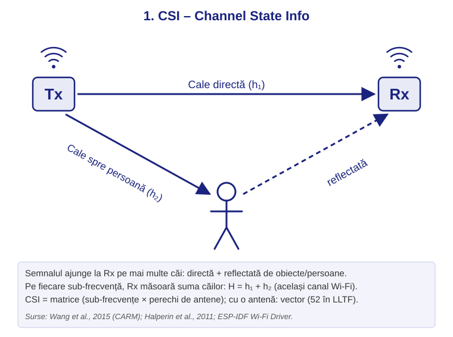
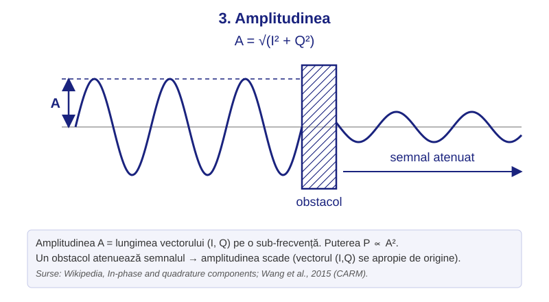
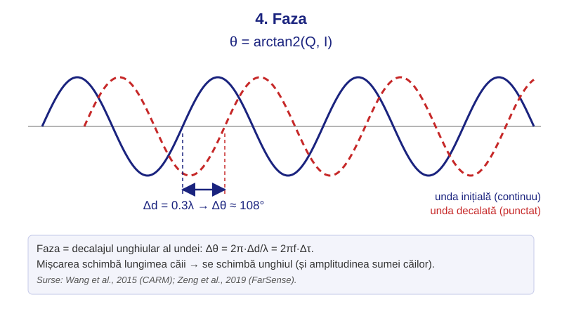
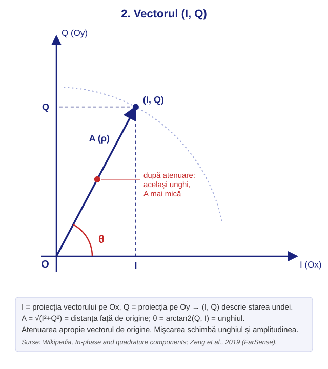

# Licență notes

5 Nov 2026

---

## 1. CSI (Channel State Info)

**Desen:** un emițător **Tx** și un receptor **Rx**.
- Între Tx și Rx: **cale directă** (ex: CH10).
- De la Tx către o persoană (om stilizat), de unde semnalul este **reflectat** către Rx (ex: CH25).

↪ canal de 20 MHz împărțit în zeci de sub-frecvențe paralele.

**CSI = matrice care descrie exact ce s-a întâmplat cu fiecare sub-frecvență.**

---

## 2. Amplitudinea și Faza

- pt. fiecare sub-frecv. h, chipul wi-fi extrage un nr. complex:

  **H(h) = I + jQ**

  - **I** = în-fază
  - **Q** = cuadratură

- **I, Q** → coordonate carteziene (x, y) ale unui vector rotativ.
  - **I** măsoară proiecția vec. pe Ox
  - **Q** măsoară proiecția vec. pe Oy
  - **(I, Q)** descrie starea undei la momentul măsurării.

**Amplitudinea** măsoară energia (puterea) totală a semnalului recepționat.

**A = √(I² + Q²)**

**Desen:** o undă sinusoidală cu amplitudine mare care întâlnește un **obstacol** (zonă hașurată), după care unda devine **atenuată** (amplitudine mică). Pe stânga este marcată amplitudinea (săgeată verticală între vârf și minim).

---

**Faza** măsoară decalajul unghiular al undei (timpul).

**θ = arctan2(Q, I)**

**Desen:** o undă sinusoidală cu un interval marcat între două puncte, notat **deplasare în spațiu**.

- Atenuarea semnalului prin obstacole reduce distanța vectorului față de origine.
- Deplasarea unui obiect modifică unghiul vectorului prin schimbarea traseului undei.

**Desen (pagina separată):** sistem de axe cu originea **O**; un vector de la origine către un punct marcat (sus), un arc de cerc cu unghiul **θ** față de axa orizontală, un al doilea punct marcat pe arc și notații **ρ** (modulul / distanța față de origine). Ilustrează vectorul (I, Q) cu amplitudinea și faza.

---

## Notes:

- ce fac funcțiile cu regiștrii de control.
- cum se modif. param. de recepție.
- de studiat ce face biblioteca.
  - → cum le trec în studiu bibliografic.
- Primul capitol mare zice de fizică, conceptual, cum scoate funcția chestiile din bibliotecă.

- De documentat și generale, analizat datele,
  nu ca să mă dovedă că s-a întâmplat x, y.

---

**!** de documentat cum scoate funcția din controllerul de wireless cu biblioteca etc.