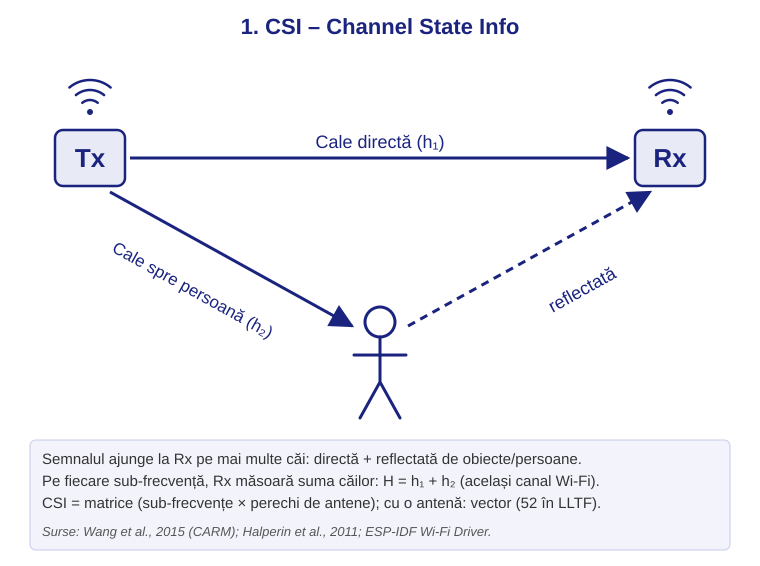
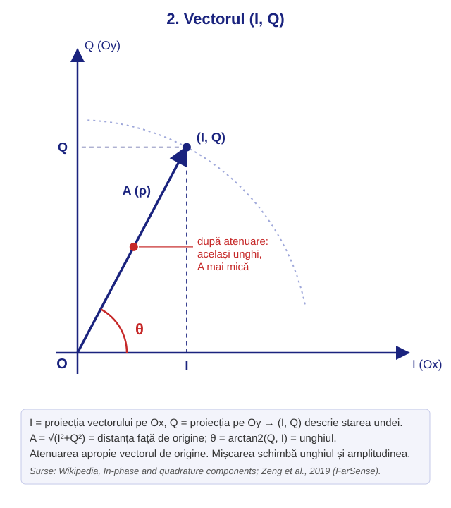
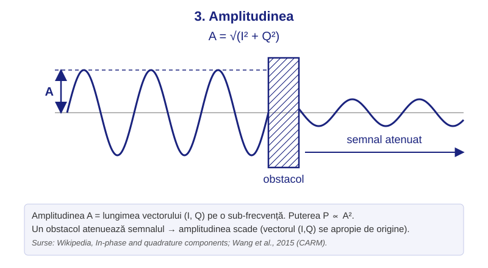
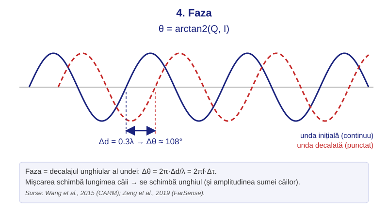

# Licență notes

5 Nov 2026

Convenție de citare:

- Textul între ghilimele „…”, în blocurile `>`, este citat exact, în limba sursei. `[…]` marchează un fragment omis. Notele de subsol din interiorul citatelor (de exemplu „[1]” din Wikipedia) sunt omise.
- Restul textului este formulare proprie. `[n]` arată sursa ideii. Lista surselor este la final.
- „(calcul propriu)” marchează un rezultat dedus de mine, care nu apare ca atare în sursă.
- Sub fiecare citat, „Traducere în română” deschide traducerea mea, marcată „(trad. proprie)”. Traducerea nu este citat exact. Referința rămâne originalul în engleză. „Subcarrier” este tradus „sub-frecvență”, ca în restul notițelor.

---

## 1. CSI (Channel State Information)

- Între Tx și Rx există o cale directă (contribuția h₁).
- Semnalul se reflectă pe o persoană și ajunge la Rx pe o cale reflectată (contribuția h₂).
- Ambele căi folosesc același canal Wi-Fi și aceleași sub-frecvențe.
- Pe fiecare sub-frecvență, Rx primește suma tuturor căilor [1]:

  **H(f) = Σₖ aₖ·e^(−j2πfτₖ)**

  - aₖ este coeficientul complex al căii k. El include atenuarea și defazajul produs de reflexii.
  - τₖ este întârzierea căii k: τₖ = dₖ/c, unde dₖ este lungimea căii și c este viteza luminii.

  > „The term aₙ is the complex-valued path coefficient for the n-th path, and τₙ = rₙ/c is the propagation delay, where rₙ is the distance the radio wave travels, and c is the speed of light.” [1, p. 4]

  

Traducere în română

  „Termenul aₙ este coeficientul complex al căii n, iar τₙ = rₙ/c este întârzierea de propagare, unde rₙ este distanța parcursă de unda radio, iar c este viteza luminii.” (trad. proprie)

  

- f este frecvența sub-frecvenței măsurate: **f = f_c + n·Δf**.
  - f_c este frecvența din centrul canalului. Exemplu: canalul 6 are f_c = 2437 MHz [6].
  - n este indicele sub-frecvenței (−26…+26 pentru LLTF).
  - Δf este distanța în frecvență dintre centrele a două sub-frecvențe vecine: 312,5 kHz [5].

  > „Of the 52 OFDM subcarriers, 48 are for data and 4 are pilot subcarriers with a carrier separation of 0.3125 MHz (20 MHz/64).” [5]

  

Traducere în română

  „Dintre cele 52 de sub-frecvențe OFDM, 48 sunt pentru date și 4 sunt sub-frecvențe pilot, cu o distanță între purtătoare de 0,3125 MHz (20 MHz/64).” (trad. proprie)

  

- Exemplu: pe canalul 6, sub-frecvența n = +10 are f = 2437 MHz + 10 × 0,3125 MHz = 2440,125 MHz (calcul propriu).
- Suma dă un singur număr complex, adică H = I + jQ din secțiunea 2. Cu formula lui Euler: I = Σₖ |aₖ|·cos(φₖ), Q = Σₖ |aₖ|·sin(φₖ), unde φₖ este faza totală a căii k (calcul propriu).

Receptorul eșantionează la 20 MHz și aplică un FFT [5]. Cu Δf = 0,3125 MHz, FFT-ul are 20 MHz / 0,3125 MHz = 64 de poziții (calcul propriu).

> „Correspondingly the receiver downconverts, samples at 20 MHz and does an FFT to retrieve the original coefficients.” [5]

Traducere în română

„În mod corespunzător, receptorul coboară semnalul în frecvență, îl eșantionează la 20 MHz și aplică un FFT ca să recupereze coeficienții inițiali.” (trad. proprie)

| Câmp pe ESP32 | Sub-frecvențe active | Sursă |
|---|---|---|
| LLTF (802.11a/g) | 52, de la −26 la +26 | [3] |
| HT-LTF (802.11n, 20 MHz) | 56, de la −28 la +28 | [3], [7] |

> „802.11a/g · -26 to +26 · -21, -7, +7, +21 · 52 total, 48 usable” și „802.11n, 20 MHz · -28 to +28 · -21, -7, +7, +21 · 56 total, 52 usable” [3, tabelul „Sub-carrier range”]

Traducere în română

„802.11a/g · de la -26 la +26 · -21, -7, +7, +21 · 52 în total, 48 utilizabile” și „802.11n, 20 MHz · de la -28 la +28 · -21, -7, +7, +21 · 56 în total, 52 utilizabile” (trad. proprie)

Intervalul −26…+26 are 53 de poziții, dar sursa dă 52 de sub-frecvențe. Poziția lipsă este 0 (componenta continuă, DC). Sursa nu spune explicit acest lucru (calcul propriu).

CSI este un set de valori complexe: o valoare pentru fiecare sub-frecvență și pentru fiecare pereche de antene Tx–Rx [7].

> „[…] the CSI contains information about the channel between sender and receiver at the level of individual data subcarriers, for each pair of transmit and receive antennas.” [7, p. 1]

Traducere în română

„[…] CSI conține informații despre canalul dintre emițător și receptor la nivelul fiecărei sub-frecvențe de date, pentru fiecare pereche de antene de emisie și de recepție.” (trad. proprie)

- În general, CSI este o matrice: sub-frecvențe × perechi de antene.
- ESP32 are un singur lanț de recepție (o antenă activă). CSI din LLTF este deci un vector de 52 de numere complexe.
- Bufferul LLTF de pe ESP32 are 64 de intrări (indicii 0~31 și −32~−1) și 128 de octeți [3]. Intrările nule sunt incluse și trebuie eliminate. 64 × 2 octeți = 128 (calcul propriu).
- Pe ESP32, primii 4 octeți din buffer pot fi invalizi. Câmpul `first_word_invalid` din `wifi_csi_info_t` arată acest caz [3]. 4 octeți = primele 2 intrări (calcul propriu).

  > „If first_word_invalid field of wifi_csi_info_t is true, it means that the first four bytes of CSI data is invalid due to a hardware limitation in ESP32.” [3]

  

Traducere în română

  „Dacă câmpul first_word_invalid din wifi_csi_info_t este true, primii patru octeți din datele CSI sunt invalizi din cauza unei limitări hardware a ESP32.” (trad. proprie)

  

- CSI nu este o măsurătoare exactă. Faza brută are erori de sincronizare (secțiunea 2) [9].

---

## 2. Amplitudinea și Faza

Pentru fiecare sub-frecvență, chipul Wi-Fi dă un număr complex:

**H = I + jQ**

- I = componenta în fază (partea reală).
- Q = componenta în cuadratură, defazată cu 90° (partea imaginară).

> „Some sources treat I/Q as a complex number; with the I and Q components corresponding to the real and imaginary parts, respectively.” [4]

Traducere în română

„Unele surse tratează I/Q ca pe un număr complex, în care componentele I și Q corespund părții reale, respectiv părții imaginare.” (trad. proprie)

I și Q sunt coordonatele carteziene (x, y) ale unui vector.

- I este proiecția vectorului pe Ox.
- Q este proiecția vectorului pe Oy.
- (I, Q) descrie starea undei la momentul măsurării.

ESP32 păstrează câte 2 octeți cu semn pe sub-frecvență. Primul octet este partea imaginară (Q). Al doilea octet este partea reală (I) [2]. Nu citi perechea ca (I, Q).

> „The first one is imaginary part and the second one is real part.” [2]

Traducere în română

„Primul este partea imaginară, iar al doilea este partea reală.” (trad. proprie)

### Amplitudinea

**A = |H| = √(I² + Q²)** (modulul unui număr complex)

- Amplitudinea este lungimea vectorului (I, Q).
- Puterea este pătratul amplitudinii: P = |H|² = I² + Q². CARM scrie puterea CFR în forma |H(f, t)|² [8].

  > „The instantaneous CFR power at time t can be derived as follows […]” [8, p. 4, ec. (3), care începe cu |H(f, t)|²]

  

Traducere în română

  „Puterea CFR instantanee la momentul t se poate obține astfel […]” (trad. proprie)

  

- Atenuarea prin obstacole reduce lungimea vectorului.

### Faza

**θ = arctan2(Q, I)**

- arctan2(y, x) dă unghiul vectorului (x, y) față de axa Ox [1]. Pentru H, x = I și y = Q.

  > „[…] where atan2(y, x) is the two-argument inverse tangent function” [1, p. 32]

  

Traducere în română

  „[…] unde atan2(y, x) este funcția arctangentă cu două argumente” (trad. proprie)

  

- Faza este un unghi. Ea arată întârzierea undei față de o referință.
- Legătura cu întârzierea τ și cu lungimea căii d: θ = 2πfτ = 2πd/λ [8].
- Când lungimea căii se schimbă cu o lungime de undă λ, faza se schimbă cu 2π [8], [9].

  > „[…] which means that when the path length changes by one wavelength, the receiver experiences a phase shift of 2π in the received subcarrier.” [8, p. 3]

  

Traducere în română

  „[…] ceea ce înseamnă că, atunci când lungimea căii se schimbă cu o lungime de undă, receptorul observă o schimbare de fază de 2π pe sub-frecvența recepționată.” (trad. proprie)

  

- Sursele scriu exponentul cu semnul minus: e^(−j2πfτ) [1], [8]. Folosește aceeași convenție în toată teza.

### Efectul mișcării

- Deplasarea unui obiect schimbă lungimea căii reflectate.
- CSI este suma unei componente statice și a unei componente dinamice. Componenta dinamică are fază variabilă [9].
- Mișcarea schimbă deci unghiul vectorului total și amplitudinea lui.

  > „[…] the paths can be grouped into static path and dynamic path.” [9, p. 7]
  >
  > „When d(t) is increased by one wavelength, the CSI (H(f, t) in Eq. 2) rotates 2π clockwise […]” [9, p. 7]

  

Traducere în română

  „[…] căile pot fi grupate într-o cale statică și o cale dinamică.” și „Când d(t) crește cu o lungime de undă, CSI (H(f, t) din ec. 2) se rotește cu 2π în sensul acelor de ceasornic […]” (trad. proprie)

  

Atenție: Nu folosi faza brută ca măsură a distanței. SFO, CFO și întârzierea de detecție a pachetului (PDD) deformează faza [9]. Corectează faza înainte de analiză.

> „The phase information of the CSI readings retrieved from commodity WiFi devices is especially noisy due to the presence of sampling frequency offset (SFO), carrier frequency offset (CFO) and packet detection delay (PDD) […]” [9, p. 5]

Traducere în română

„Informația de fază din citirile CSI obținute de la dispozitivele WiFi comerciale are un zgomot deosebit de mare din cauza decalajului frecvenței de eșantionare (SFO), a decalajului frecvenței purtătoare (CFO) și a întârzierii de detecție a pachetului (PDD) […]” (trad. proprie)

Pe plăcile cu mai multe antene există și offseturi de fază între lanțurile RF [10]. ESP32 are un singur lanț de recepție. Deci offsetul dintre antene nu apare pe ESP32.

> „[…] the phase offset between receive antennas is due to random phase rotations semi-time-invariant with up to four possible values.” [10, p. 1]

Traducere în română

„[…] offsetul de fază dintre antenele de recepție provine din rotații de fază aleatoare, aproape invariante în timp, cu cel mult patru valori posibile.” (trad. proprie)

---

## Notes:

- ce fac funcțiile cu regiștrii de control.
- cum se modif. param. de recepție.
- de studiat ce face biblioteca.
  - → cum le trec în studiu bibliografic.
- Primul capitol mare zice de fizică, conceptual, cum scoate funcția chestiile din bibliotecă.
- De documentat și generale, analizat datele,
  nu ca să dovedesc că s-a întâmplat x, y.

---

**!** de documentat cum scoate funcția din controllerul de wireless cu biblioteca etc.

---

## Surse

Paginile web au fost accesate pe 5 Nov 2026. PDF-urile [7], [8] și [9] sunt locale, în `docs/Materials/CSI_Sensing/sources-2026-10-21/`. Capturile cu fragmentele citate sunt în `Status_5Nov_2026_surse.html`.

1. F. Aït Aoudia, J. Hoydis, M. Nimier-David, S. Cammerer, A. Keller, „Sionna RT: Technical Report”, arXiv:2504.21719v1, 2025. <https://arxiv.org/abs/2504.21719>
2. Espressif Systems, *ESP-IDF Programming Guide v4.3.3 (ESP32)*, „Wi-Fi Driver”, secțiunea „Wi-Fi Channel State Information”. <https://docs.espressif.com/projects/esp-idf/en/v4.3.3/esp32/api-guides/wifi.html>
3. Espressif Systems, *ESP-IDF Programming Guide v6.0 (ESP32)*, „Wi-Fi Vendor Features”. <https://docs.espressif.com/projects/esp-idf/en/v6.0/esp32/api-guides/wifi-driver/wifi-vendor-features.html>
4. Wikipedia, „In-phase and quadrature components”, secțiunea „I/Q data”. <https://en.wikipedia.org/wiki/In-phase_and_quadrature_components>
5. Wikipedia, „IEEE 802.11a-1999”, secțiunea „Technical description”. <https://en.wikipedia.org/wiki/IEEE_802.11a-1999>
6. Wikipedia, „List of WLAN channels”, tabelul pentru banda de 2,4 GHz. <https://en.wikipedia.org/wiki/List_of_WLAN_channels>
7. D. Halperin, W. Hu, A. Sheth, D. Wetherall, „Tool Release: Gathering 802.11n Traces with Channel State Information”, *ACM SIGCOMM Computer Communication Review*, vol. 41, nr. 1, ian. 2011. Fișier: `Halperin_2011_Tool_Release_80211n_CSI.pdf`
8. W. Wang, A. X. Liu, M. Shahzad, K. Ling, S. Lu, „Understanding and Modeling of WiFi Signal Based Human Activity Recognition”, *MobiCom '15*, Paris, sept. 2015. DOI: 10.1145/2789168.2790093. Fișier: `Wang_2015_Understanding_Modeling_WiFi_HAR_CARM.pdf`
9. Y. Zeng, D. Wu, J. Xiong, E. Yi, R. Gao, D. Zhang, „FarSense: Pushing the Range Limit of WiFi-based Respiration Sensing with CSI Ratio of Two Antennas”, *Proc. ACM IMWUT*, vol. 3, nr. 3, art. 121, sept. 2019. DOI: 10.1145/3351279. Fișier: `Zeng_2019_FarSense_Respiration_CSI_Ratio.pdf`
10. A. Zubow, P. Gawłowicz, F. Dressler, „On Phase Offsets of 802.11ac Commodity WiFi”, *WONS 2021*, mar. 2021. DOI: 10.23919/WONS51326.2021.9415548. <https://www.ccs-labs.org/bib/zubow2021phase/zubow2021phase.pdf>

Wikipedia [4], [5], [6] este o sursă secundară. În teză, înlocuiește aceste trimiteri cu standardul IEEE 802.11 sau cu o carte de comunicații digitale.
