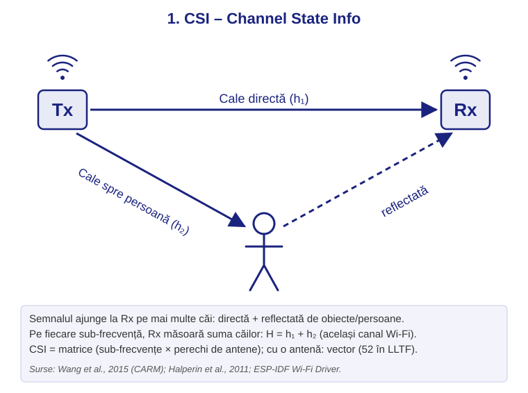
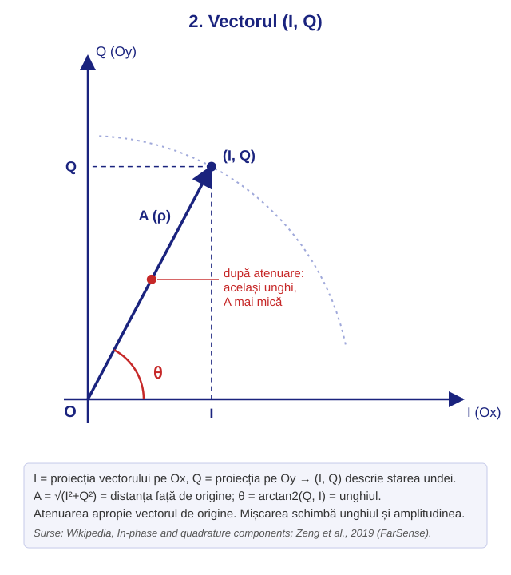
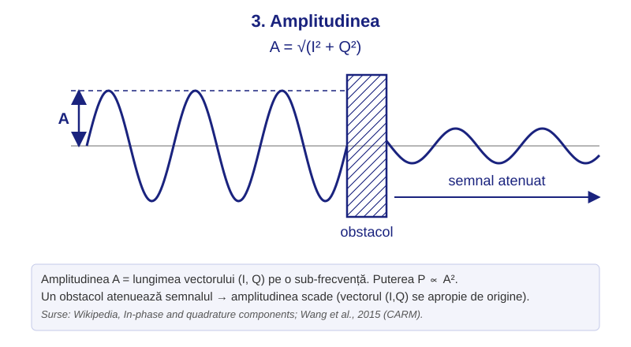
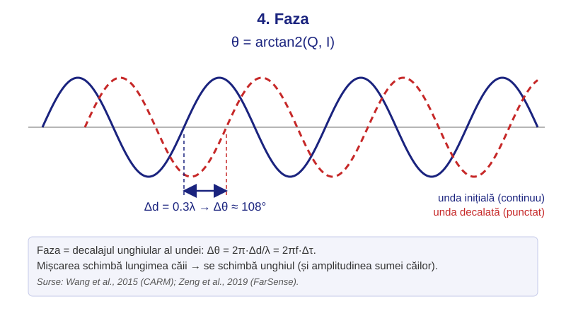

# Licență – varianta scurtă

5 Nov 2026 · Detaliile, citatele și sursele sunt în `Status_5Nov_2026_final.md`.

---

## 1. Ce este CSI

- Routerul (Tx) trimite un semnal Wi-Fi. Placa ESP32 (Rx) îl primește.
- Semnalul ajunge pe mai multe drumuri: direct și reflectat de oameni sau de pereți.
- Rx primește **suma** tuturor drumurilor.
- Canalul Wi-Fi este împărțit în multe frecvențe mici, numite **sub-frecvențe**, la 312,5 kHz una de alta.
- **CSI** = câte un număr pentru fiecare sub-frecvență. Pe ESP32: **52 de numere** la fiecare pachet.
- Când cineva se mișcă, drumul reflectat se schimbă. Deci și CSI se schimbă. Așa „vede” Wi-Fi-ul mișcarea.

---

## 2. Fiecare număr este o săgeată

Fiecare număr CSI are două părți: **H = I + jQ**.

- **I** = cât merge săgeata pe orizontală.
- **Q** = cât merge săgeata pe verticală.
- Pe ESP32 vine întâi Q, apoi I. Atenție la ordine când citești datele.

Din săgeată scoatem două lucruri:

| Ce | Ce înseamnă | Formula |
|---|---|---|
| **Amplitudine** | lungimea săgeții = cât de puternic e semnalul | A = √(I² + Q²) |
| **Fază** | unghiul săgeții = cât de întârziată e unda | θ = atan2(Q, I) |

---

## 3. Amplitudinea

- Un obstacol (om, perete) slăbește semnalul. Săgeata devine mai scurtă.

---

## 4. Faza

- Faza arată cât a întârziat unda pe drum.
- Dacă drumul crește cu o lungime de undă (cam 12 cm pe Wi-Fi 2,4 GHz), săgeata face o tură completă, ca acul unui ceas.
- Atenție: faza brută de pe ESP32 are erori de sincronizare. Nu o folosi direct, fără corecție.

---

## Pe scurt

- CSI = 52 de săgeți la fiecare pachet Wi-Fi.
- Lungimea săgeții = puterea semnalului. Unghiul = întârzierea.
- Mișcarea unui om schimbă săgețile. Din schimbare aflăm că s-a mișcat ceva.
