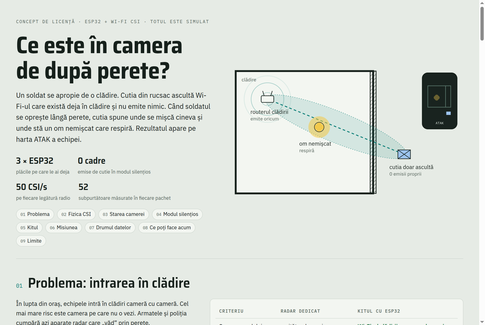
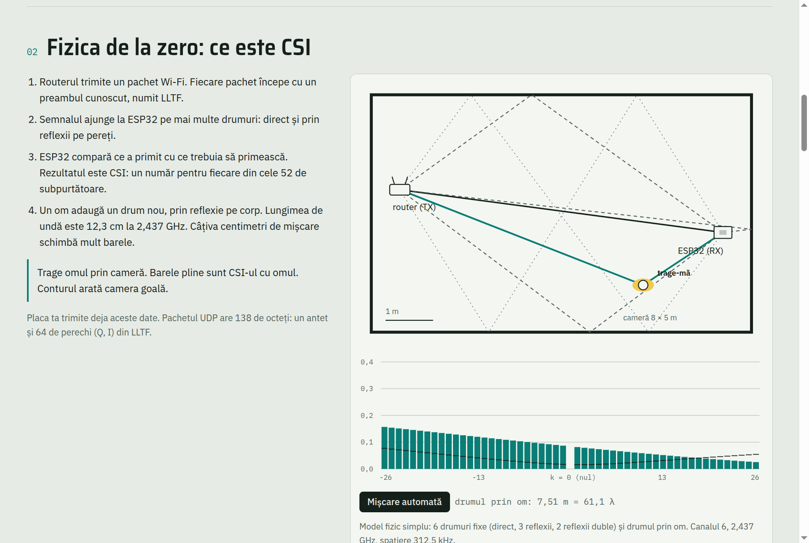
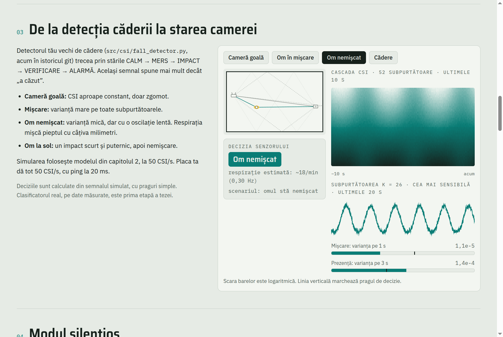
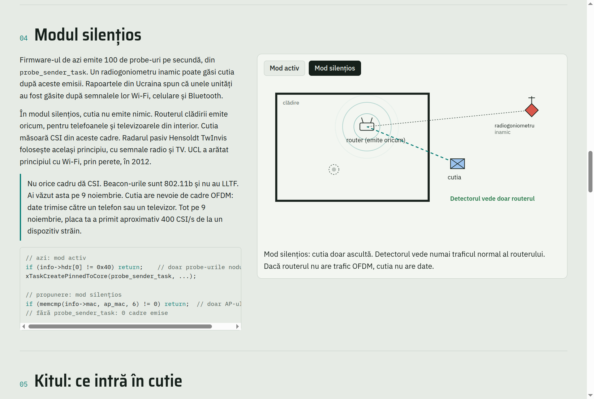
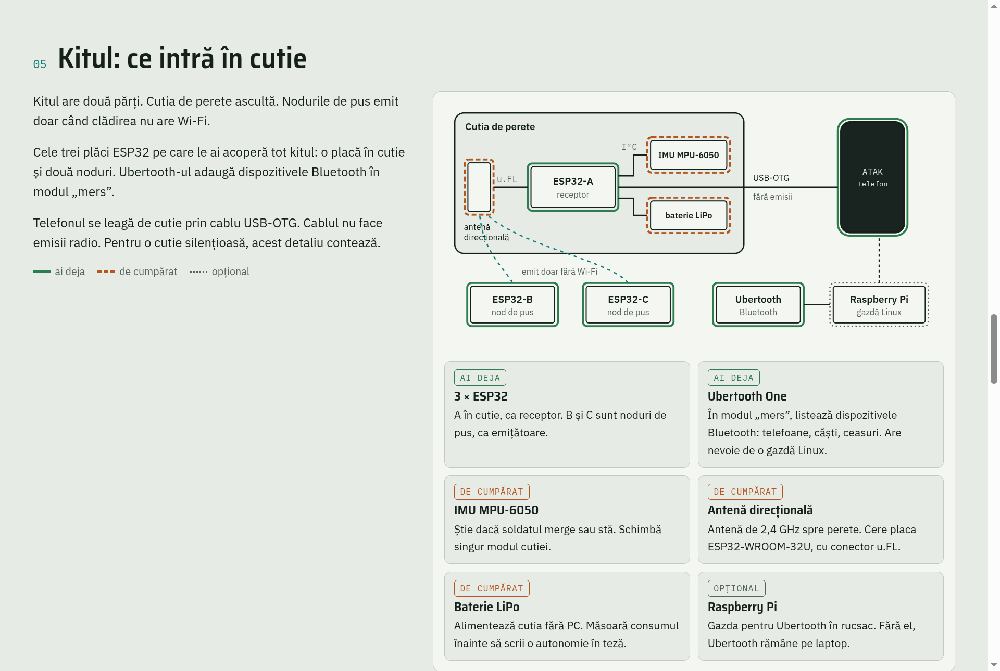
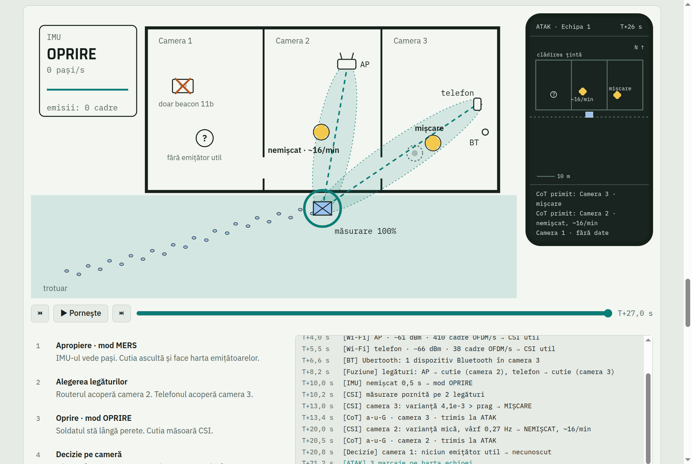
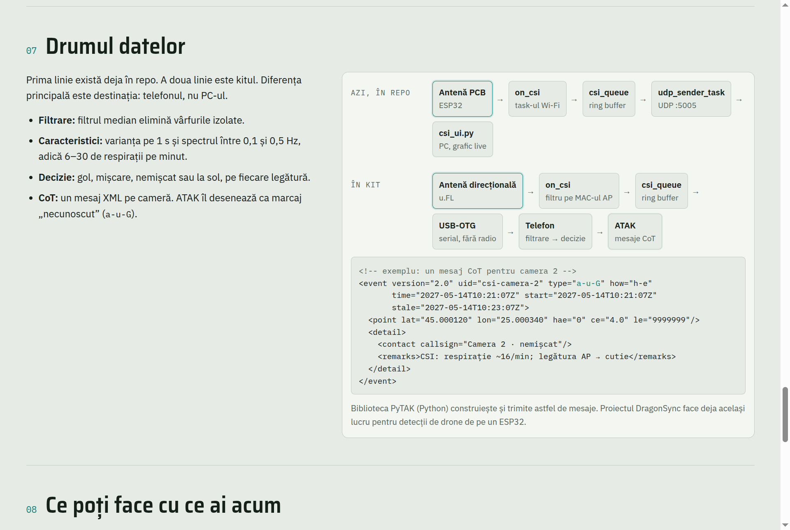

# Senzor tactic silențios cu Wi-Fi CSI

Data: 2026-11-12. Stare: concept. Nu există cod nou pentru această idee.

## Fișierele din acest folder

| Fișier | Conținut |
|---|---|
| [README.md](README.md) | Conceptul, kitul, planul tezei, limitele și ideile respinse |
| [surse.md](surse.md) | Toate linkurile din cercetare, grupate pe teme, cu ce am găsit în fiecare |
| [de-cautat.md](de-cautat.md) | Golurile din cercetare: ce trebuie să căutăm data viitoare |
| [ilustratii/senzor-tactic.html](ilustratii/senzor-tactic.html) | Pagina animată cu tot conceptul (9 capitole, simulări, misiune) |
| [ilustratii/capturi/](ilustratii/capturi/) | Capturi de ecran din pagina animată |
| [ilustratii/test_simulator.js](ilustratii/test_simulator.js) | Testul simulatorului din capitolul 3 al paginii |

Pagina publicată (privată): https://claude.ai/artifact/KNdX1fW8s4TqHtCm2RdpTY

Pentru a deschide pagina local, deschide `ilustratii/senzor-tactic.html` în browser. Pagina are nevoie de internet pentru fonturi (Google Fonts) și pentru GSAP 3.12.5 (cdnjs). Fără internet, animația misiunii arată doar starea finală.

Pentru a rula testul simulatorului:

```bash
node docs/idei/senzor-tactic-wifi-csi/ilustratii/test_simulator.js
```

## De unde a pornit ideea

Utilizatorul a văzut un video despre Palantir și Anduril. Scopul este o licență care arată bine în CV pentru firmele de apărare. Condiții:

- Baza actuală rămâne: nodurile ESP32, CSI și ideea de detecție a căderii.
- Peste bază, putem adăuga alte tehnologii și gadgeturi.
- Aplicația trebuie să fie tactică, ofensivă sau defensivă. Salvarea victimelor nu este suficientă.
- Kitul trebuie să fie mobil: o cutie mică sau un rucsac pentru un soldat.

## Conceptul pe scurt

Un soldat se apropie de o clădire. Cutia din rucsac ascultă Wi-Fi-ul care există deja în clădire și nu emite nimic. Când soldatul se oprește lângă perete, cutia spune în ce cameră se mișcă cineva. Cutia spune și unde stă un om nemișcat care respiră. Rezultatul apare pe harta ATAK a echipei, ca mesaj CoT.



## Fizica CSI pe scurt

Routerul trimite un pachet cu un preambul cunoscut (LLTF). Semnalul ajunge la ESP32 pe mai multe drumuri. ESP32 calculează CSI: un număr pentru fiecare din cele 52 de subpurtătoare. Un om adaugă un drum nou, prin reflexie pe corp. Lungimea de undă este 12,3 cm la 2,437 GHz, deci câțiva centimetri de mișcare schimbă CSI.



## Legătura cu detecția căderii

Detectorul vechi de cădere (`src/csi/fall_detector.py`, acum doar în istoricul git) avea stările CALM → MERS → IMPACT → VERIFICARE → ALARMĂ. Același semnal CSI poate clasifica starea unei camere:

| Stare | Semnul în CSI |
|---|---|
| Cameră goală | CSI aproape constant, doar zgomot |
| Mișcare | Varianță mare pe toate subpurtătoarele |
| Om nemișcat | Varianță mică, cu o oscilație lentă de 0,1–0,5 Hz (respirația) |
| Om la sol | Un impact scurt și puternic, apoi nemișcare |

Comanda pentru a vedea codul vechi:

```bash
git show HEAD~5:src/csi/fall_detector.py
```



## Modul silențios

Firmware-ul de azi emite 100 de probe-uri pe secundă din `probe_sender_task`. Un radiogoniometru inamic poate găsi cutia după aceste emisii. În modul silențios, cutia nu emite nimic. Cutia măsoară CSI din cadrele OFDM pe care routerul clădirii le trimite oricum.

Același principiu există în produse și în cercetare:

- Hensoldt TwInvis: radar pasiv cu semnale radio și TV.
- UCL (Chetty, 2012): radar Wi-Fi pasiv, prin perete, cu un receptor de mărimea unei valize.
- Întrebarea de cercetare: un ESP32 de sub 10 EUR poate face ce făcea valiza?

Ce știm deja de pe placa noastră (9 noiembrie 2026):

- Beacon-urile sunt 802.11b și nu dau CSI.
- În mod promiscuu, placa a primit aproximativ 400 CSI/s de la un dispozitiv străin, fără probe-uri proprii.

Schimbarea propusă în firmware:

```c
// azi: mod activ
if (info->hdr[0] != 0x40) return;    // doar probe-urile nodurilor
xTaskCreatePinnedToCore(probe_sender_task, ...);

// propunere: mod silențios
if (memcmp(info->mac, ap_mac, 6) != 0) return;  // doar AP-ul ales
// fără probe_sender_task: 0 cadre emise
```

Linia de azi este [main.c:36](../../../src/firmware/esp32_csi_node/main/main.c#L36).



## Kitul mobil

Kitul are două părți:

| Parte | Conținut | Când o folosești |
|---|---|---|
| Cutia de perete | ESP32 cu antenă direcțională, IMU, baterie, carcasă 3D | Clădirea are un router activ. Routerul este emițătorul. Cutia doar ascultă. |
| Nodurile de pus | 2 ESP32 mici, cu baterie | Clădirea nu are Wi-Fi. Soldatul pune un nod la alt perete. Nodul devine emițătorul. |

Telefonul cu ATAK se leagă de cutie prin USB-OTG. Cablul nu face emisii radio.

Hardware-ul pe care îl ai: 3 × ESP32 și 1 × Ubertooth One. Nimic altceva.

| Piesă | Stare | Rol |
|---|---|---|
| 3 × ESP32 | ai deja | A = receptorul din cutie. B și C = noduri de pus. |
| Ubertooth One | ai deja | Listează dispozitivele Bluetooth în modul MERS. Are nevoie de o gazdă Linux. |
| IMU MPU-6050 | de cumpărat | Știe dacă soldatul merge sau stă. Schimbă singur modul. |
| ESP32-WROOM-32U + antenă direcțională 2,4 GHz | de cumpărat | Conector u.FL. Antena privește spre perete. |
| Baterie LiPo | de cumpărat | Alimentare fără PC. Măsoară consumul înainte să scrii o autonomie. |
| Raspberry Pi | opțional | Gazda pentru Ubertooth în rucsac |
| Radar UWB | opțional, mai târziu | Singura cale reală pentru detecție în mers |



## Senzorul și mersul soldatului

CSI nu poate măsura cât timp cutia se mișcă:

- Mișcarea cutiei schimbă toate drumurile semnalului. Efectul este mai mare decât efectul omului din cameră.
- Pe ESP32, faza CSI are un decalaj aleator la fiecare pachet. Compensarea mișcării proprii nu este directă.
- Banda de 20 MHz dă o rezoluție în distanță de aproximativ 7,5 m.

Soluția propusă: două moduri, schimbate automat de IMU.

| Mod | Când pornește | Ce face |
|---|---|---|
| MERS | IMU-ul vede pași | Ascultă pasiv toate dispozitivele Wi-Fi și Bluetooth. Face o hartă a emițătoarelor, cu RSSI și traseul din pași. |
| OPRIRE | Cutia stă nemișcată 0,5 s | Măsoară CSI de la cel mai bun emițător găsit în mers |

Lucrarea „Et Tu Alexa?” (arXiv 1810.10109) folosește aceeași idee: telefon, senzori de mișcare și dispozitivele Wi-Fi din clădire.

Upgrade pentru detecție reală în mers: un radar UWB (banda de aproximativ 500 MHz, rezoluție de aproximativ 30 cm). Nu am găsit teste prin perete pentru cipurile UWB ieftine.



## Drumul datelor

| Azi, în repo | În kit |
|---|---|
| Antenă PCB | Antenă direcțională (u.FL) |
| `on_csi` (task-ul Wi-Fi) | `on_csi` cu filtru pe MAC-ul AP |
| `csi_queue` (ring buffer) | `csi_queue` (ring buffer) |
| `udp_sender_task` (UDP 5005) | USB-OTG (serial, fără radio) |
| `csi_ui.py` pe PC | Telefon: filtrare, decizie, apoi ATAK (CoT prin PyTAK) |

Exemplu de mesaj CoT (`a-u-G` = obiect necunoscut la sol):

```xml
<event version="2.0" uid="csi-camera-2" type="a-u-G" how="h-e"
       time="2027-05-14T10:21:07Z" start="2027-05-14T10:21:07Z"
       stale="2027-05-14T10:23:07Z">
  <point lat="45.000120" lon="25.000340" hae="0" ce="4.0" le="9999999"/>
  <detail>
    <contact callsign="Camera 2 · nemișcat"/>
    <remarks>CSI: respirație ~16/min; legătura AP → cutie</remarks>
  </detail>
</event>
```



## Planul tezei

| Etapă | Ce demonstrezi | Hardware | Ai tot? |
|---|---|---|---|
| 1 | Clasificatorul de stare: gol, mișcare, nemișcat, cădere | 2 × ESP32, PC | da |
| 2 | Același clasificator prin perete: cât pierzi | 2 × ESP32, un perete din casă | da |
| 3 | Modul silențios: activ comparat cu pasiv | 1 × ESP32, routerul tău, un telefon care face trafic | da |
| 4 | Respirația unui om nemișcat | montajul din etapa 2 sau 3 | da |
| 5 | Marcaje pe harta ATAK (PyTAK, CoT) | telefon Android cu ATAK-CIV | probabil |
| 6 | Comutare automată MERS / OPRIRE | IMU MPU-6050 | nu, ieftin |
| 7 | Cutia mobilă, pe baterie | ESP32-WROOM-32U, antenă, baterie, carcasă 3D | nu |
| 8 | Bluetooth în modul MERS | Ubertooth, Raspberry Pi | parțial |

Etapele 1–5 nu cer nicio cumpărătură. Pasul următor propus: etapa 3, cu o placă și routerul de acasă.

Capitol opțional „atac și apărare”: un inamic poate pune un ESP32 lângă propriul punct de comandă și poate vedea oamenii prin Wi-Fi. IRShield (IEEE S&P 2022) reduce această detecție la 5% sau mai puțin.

## Piața și relevanța pentru CV

- Categoria militară: UGS (Unattended Ground Sensors). Exemple: Project Q (kit UGS, Eurosatory 2026), Bertin Exensor Flexnet, McQ.
- Senzori prin perete: Lumineye Lux, L3Harris Range-R, Camero Xaver.
- Rețele de senzori ieftini: Sky Fortress (Ucraina), aproximativ 9.500 de senzori acustici de 400–500 USD.
- NATO DIANA 2027 are provocarea „Multidomain Sensing and Advanced Data Processing for Intelligence and Surveillance”.
- În România nu am găsit nicio firmă pentru senzori prin perete. Aproape toate firmele noi lucrează pe drone și anti-dronă.

Rândul propus pentru CV: „Passive through-wall Wi-Fi sensing on ESP32 with TAK (CoT) integration”. Cuvinte cheie: ISR, UGS, passive sensing, EMCON, sensor fusion, ATAK, ESP-IDF, DSP.

## Limite

- Senzorul măsoară doar când cutia stă pe loc.
- Rezoluția este „camera”, nu „la 3 m”.
- Betonul armat atenuează mult semnalul de 2,4 GHz. Cărămida și gips-cartonul atenuează mai puțin.
- Modul silențios are nevoie de cadre OFDM. Un router fără clienți activi dă doar beacon-uri, fără CSI.
- Telefoanele moderne își schimbă adresa MAC. Numărul de telefoane din modul MERS este aproximativ.
- Fă testele doar în spațiul tău, cu rețeaua ta și cu voluntari care știu de test.

Toate valorile din pagina animată sunt ilustrative, în afară de cele marcate „placa ta”. Nu copia aceste cifre în teză ca rezultate.

## Idei respinse (nu le propune din nou)

| Idee | Ce era | De ce nu |
|---|---|---|
| A. Detecția intrușilor | Alarmă când cineva intră într-o zonă | Utilizatorul nu a vrut această idee. |
| B. Securitatea senzorului | Un ESP32 atacator falsifică probe-uri. Apărare prin MAC și forma CSI. | Utilizatorul nu a vrut această idee. Rămâne doar ca un capitol opțional. |
| C. Detecția dronelor | Remote ID pe ESP32 sau CSI pe elice | Utilizatorul nu a vrut această idee. Are nevoie de o dronă. |
| D. „Lattice” mic | Fuziunea detecțiilor pe o hartă comună | Utilizatorul nu a vrut această idee ca temă separată. ATAK o acoperă acum în concept. |
| Pre-triajul victimelor | Cădere → victimă → respirație → triaj, după cutremur sau atac | Salvarea nu contează destul pentru CV. Utilizatorul vrea ceva tactic. |

## Întrebări deschise

1. Coordonatorul acceptă o temă tactică?
2. Ai un telefon Android pentru ATAK-CIV?
3. Ai acces la o cameră cu perete de cărămidă și la un voluntar?
4. Poți cumpăra un IMU MPU-6050?
